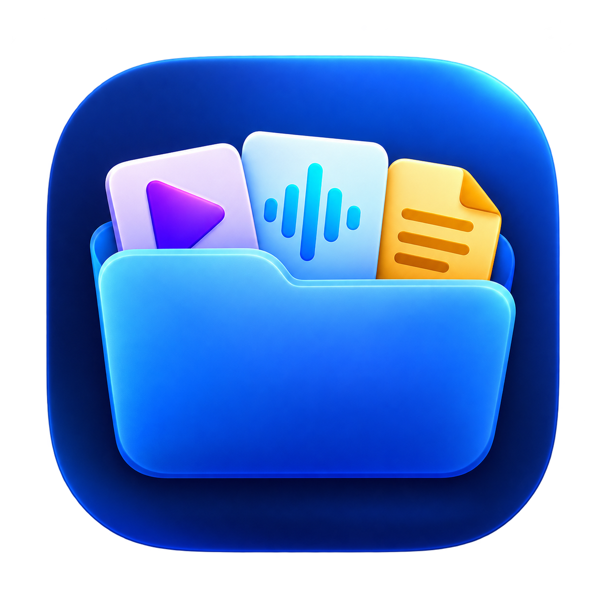
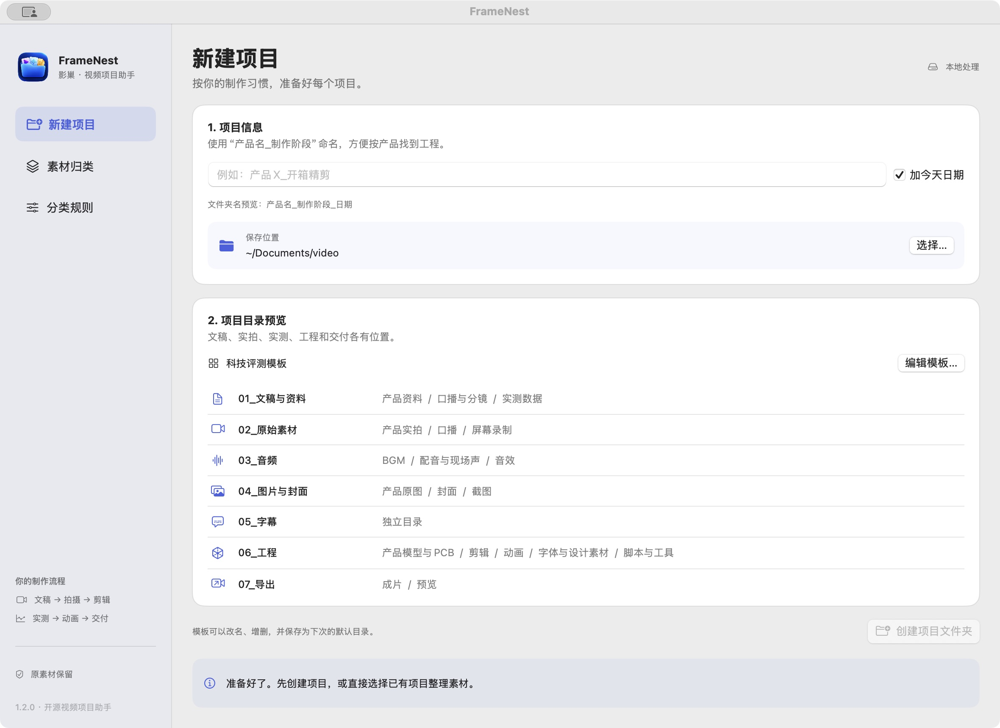

<p align="center">
  
</p>

# FrameNest · 影巢

**为视频创作者准备的 macOS 项目文件夹与素材整理工具。**

一键生成项目目录，预览素材去向，再复制归类。把文稿、拍摄素材、实测数据、剪辑工程、动画和交付文件放到各自的位置。

[English ↓](#english) · [下载 / Downloads](https://github.com/weixunkkkkk/framenest/releases) · [MIT License](LICENSE)



## 能做什么

- **一键新建项目**：项目名、日期后缀、保存位置和目录模板可配置。
- **图形目录预览**：分类图标和子目录一目了然，模板支持编辑与保存。
- **复制前预览**：显示文件类型、建议分类和判断依据，支持搜索、待确认筛选及逐项调整。
- **保留原素材**：采用复制归类；内容相同则跳过，同名不同内容自动加序号。
- **保留工程结构**：识别剪映、ChatCut、PR、达芬奇、HyperFrames、Remotion 等工程标识，整体复制目录。
- **本地处理**：无需账号、网络或外部 AI 服务。整理过程生成 Markdown 记录。

分类使用文件名、最近的父目录和文件格式，不会分析视频画面。用途不明确的文件进入“待确认”，由你在预览中决定。

## 安装与使用

要求 **macOS 14 或更新版本**。当前预编译包面向 **Apple Silicon（arm64）**；界面使用简体中文，本 README 提供中英文说明。

1. 从 [Releases](https://github.com/weixunkkkkk/framenest/releases) 下载 `FrameNest-…-macOS-arm64.zip`。
2. 解压后将 `FrameNest.app` 放入“应用程序”。
3. 在“新建项目”中输入项目名，选择保存位置，点击“创建项目文件夹”。
4. 进入“素材归类”，选择素材来源与目标项目，点击“扫描并预览”。
5. 检查或修改分类，再点击“复制归类”。

预编译包使用 ad-hoc 本地签名，未进行 Apple 公证，也可以按下文从源码构建。

## 默认项目结构

```text
产品X_开箱评测_20261024/
├── 01_文稿与资料/     # 口播与分镜、产品资料、实测数据
├── 02_原始素材/       # 口播、产品实拍、屏幕录制
├── 03_音频/           # 配音与现场声、BGM、音效
├── 04_图片与封面/     # 产品原图、截图、封面
├── 05_字幕/
├── 06_工程/           # 剪辑、动画、模型与PCB、字体设计、脚本工具
├── 07_导出/           # 预览、成片
├── 08_交付与发布/     # 发布文案、交付记录、整理记录
├── 09_待确认/
└── 项目说明.md
```

在“编辑模板”中修改每行目录，使用 `/` 表示子目录。模板影响之后创建的项目；分类预览也可以选择模板中的自定义目录。

## 文件识别与归类

| 类型 | 示例格式与处理 |
|---|---|
| 视频与相机素材 | MP4、MOV、MXF、BRAW、R3D、INSV 等；结合名称区分口播、实拍、录屏、预览与成片 |
| 音频 | WAV、MP3、M4A、FLAC、OPUS 等；区分 BGM、音效、配音和现场证据音 |
| 字幕与转写 | SRT、ASS、VTT、LRC，以及 `.wav.txt`、`.mp4.txt` 和有明确名称的 ASR JSON |
| 产品资料 | PDF、DOCX、PPTX、Pages、Keynote、规格压缩包；有用途依据时归产品资料 |
| 数据文件 | CSV、Excel、Parquet、Feather、Arrow；防抖轨迹与实测数据分别判断 |
| 产品模型与 PCB | STEP、STL、GLB、FBX、OBJ、USD、EasyEDA、KiCad 等 |
| 字体与设计 | OTF、TTF、WOFF、PSD、AI、AFDesign、SVG 等 |
| 剪辑与动画工程 | PRPROJ、DRP、FCPXML、ChatCut、剪映草稿、BLEND、AEP、HyperFrames、Remotion 等 |
| 脚本与工具 | Python、JavaScript、TypeScript、Shell、Swift 等 |

例如：

- `口播/审片版V2.mp4` → `07_导出/预览`。
- `BGM/啸叫原声.wav` → `03_音频/配音与现场声`。
- `KM003C_烤机60W.parquet` → `01_文稿与资料/实测数据`。
- `外壳.step` → `06_工程/产品模型与PCB`。
- `C0001.mp4`、用途不明的 PDF 和表格 → `09_待确认`。

复制时保留原文件名与原子目录。来源和目标不能相同或互相包含；散落的隐藏项、缓存、应用包与符号链接会跳过。识别为完整工程的目录整体复制，内部资源也一起保留。

## 从源码构建

使用 Xcode Command Line Tools 中的 Swift，项目无第三方包依赖。

```bash
git clone https://github.com/weixunkkkkk/framenest.git
cd framenest
bash Scripts/package_app.sh release
FrameNest.app/Contents/MacOS/FrameNest --self-test
```

构建输出为仓库根目录的 `FrameNest.app`。打包脚本会生成多尺寸图标并进行 ad-hoc 签名。

```bash
# 只编译源码
swift build -c release

# 打包为可下载的 arm64 ZIP，并生成 SHA-256
bash Scripts/package_release.sh
```

核心自检覆盖分类优先级、工程完整复制、原文件保留、重复跳过、同名保护及路径边界。源码通过本机架构构建；当前发布的预编译包不包含 Intel 版本。

## 贡献与许可

欢迎提交 Issue 或 Pull Request，补充新的素材类型、分类案例和工作流模板。分类规则位于 `Sources/FrameNest/Organizer.swift`，图形界面位于 `Interface.swift`。

项目使用 [MIT License](LICENSE)。应用图标由 AI 辅助生成，与项目源码一同提供。

---

## English

**FrameNest is a local macOS project-folder and media organizer for video creators.**

Create a project structure, preview where files will go, and copy them into categories for scripts, footage, test data, editing projects, animation, and delivery.

### Features

- **Create projects in one step:** configure the project name, date suffix, destination, and folder template.
- **Visual folder preview:** inspect category icons and subfolders, then edit and save your template.
- **Review before copying:** see file types, suggested destinations, and classification reasons; search, filter uncertain items, and override categories.
- **Keep source files:** copies retain original names and relative subfolders. Identical contents are skipped; different contents with the same name receive a numeric suffix.
- **Keep recognized projects intact:** supported project markers include Jianying/CapCut, ChatCut, Premiere Pro, DaVinci Resolve, HyperFrames, and Remotion.
- **Work locally:** no account, network connection, or external AI service is required. Each operation creates a Markdown report.

Classification uses names, nearby parent folders, and file formats. It does not analyze video content. Ambiguous files go to a review category for manual confirmation.

### Requirements and installation

- **macOS 14 or newer**.
- Prebuilt downloads currently target **Apple Silicon / arm64**.
- The application UI is currently **Simplified Chinese**. Documentation is bilingual.

Download the ZIP from [Releases](https://github.com/weixunkkkkk/framenest/releases), extract it, and move `FrameNest.app` to Applications. Prebuilt apps are ad-hoc signed and are not Apple-notarized. You can also build from source.

### Typical workflow

1. Open the first sidebar page, enter a project name, choose a location, and create the project folders.
2. Open the media organization page and select the source and destination folders.
3. Scan the source, review suggested categories, and change any uncertain assignments.
4. Copy the selected items. Original files remain in place, and the destination receives a Markdown operation report.

The default template separates scripts and reference documents, footage, audio, images and covers, subtitles, editing and animation projects, exports, delivery records, and items needing review. Templates use one relative path per line, with `/` for subfolders.

### Supported file families

| Family | Examples |
|---|---|
| Video and camera footage | MP4, MOV, MXF, BRAW, R3D, INSV |
| Audio | WAV, MP3, M4A, FLAC, OPUS |
| Captions and transcripts | SRT, ASS, VTT, LRC, audio/video transcript sidecars, clearly named ASR JSON |
| Product documents | PDF, DOCX, PPTX, Pages, Keynote, clearly named specification archives |
| Test data | CSV, Excel, Parquet, Feather, Arrow; stabilization data is treated separately |
| Models and PCB | STEP, STL, GLB, FBX, OBJ, USD, EasyEDA, KiCad |
| Fonts and design sources | OTF, TTF, WOFF, PSD, AI, AFDesign, SVG |
| Editing and animation projects | PRPROJ, DRP, FCPXML, ChatCut, Jianying drafts, BLEND, AEP, HyperFrames, Remotion |
| Scripts and tools | Python, JavaScript, TypeScript, Shell, Swift |

Specific file names take priority over generic parent-folder hints. For example, a review export inside a talking-head folder remains a preview export, and a recording of equipment noise inside a BGM folder remains source audio. Unknown PDFs, spreadsheets, and camera-numbered clips are left for review.

Source and destination folders must not overlap. Loose hidden files, caches, application bundles, and symbolic links are skipped. Recognized project folders are copied as complete units, including their internal resources.

### Build from source

Install Xcode Command Line Tools. No third-party Swift packages are required.

```bash
git clone https://github.com/weixunkkkkk/framenest.git
cd framenest
bash Scripts/package_app.sh release
FrameNest.app/Contents/MacOS/FrameNest --self-test
```

The build produces `FrameNest.app` in the repository root, including icon resources and an ad-hoc signature. Use `bash Scripts/package_release.sh` to create a versioned ZIP and SHA-256 file. Source builds use the host Mac's architecture; no Intel prebuilt download is currently provided.

Self-checks cover classification precedence, complete project copying, source preservation, duplicate detection, same-name handling, and path boundaries.

### Contributing and license

Issues and pull requests are welcome, especially new media formats, classification examples, and workflow templates. Rules live in `Sources/FrameNest/Organizer.swift`; the visual interface lives in `Interface.swift`.

Released under the [MIT License](LICENSE). The application icon was created with AI assistance and is included with the source.
